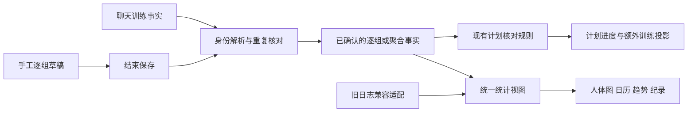

# 健身网页增强修改计划

日期：2026-11-07  
状态：已在本地实施。实现结果和验证边界见 `docs/training-enhancements-validation.md`；尚未发布线上。  
目标：在现有“一周训练记录”中增加肌肉分布图、训练统计、逐组记录，并参考 openGym 补充、校正动作库。

## 1. 范围与实现选择

沿用当前静态 HTML/PWA、原生 JavaScript、localStorage 和 Supabase 同步。保留现有移动端卡片、底部导航、周计划、历史、AI 教练和角色聊天。

本次交付四项：

1. 肌肉分布图：计划预览、实际训练分布、点选肌群追溯动作。
2. 训练统计：概览、训练日历、动作趋势、个人纪录。
3. 逐组记录：次数、外加重量、时长、左右侧、可选用力程度。
4. 动作库：审校现有 68 条文件记录，补入 openGym 中有依据的常用动作，完善筛选和详情。

本次不加入自动进阶、疲劳恢复预测、排行榜、openGym 账号系统或其独立后端。数据继续由现有网页管理。人体图表达“记录中的训练分布”，不表达真实肌肉增长、医学恢复状态或动作正确性。

## 2. 已核实的项目现状

| 项目 | 当前情况 | 对实施的影响 |
|---|---|---|
| 页面入口 | `index.html` | 继续作为正式代码来源 |
| 功能副本 | `index-liquid-glass-functional.html`，由脚本生成 | 修改后重新生成，避免手改两套 |
| 导航 | 计划、记录、历史、工具 | 保持四个入口；统计放入“历史” |
| 动作文件 | `训练动作库/actions.json` 有 68 条，键无重复 | 旧键保留，新增键另建 |
| 文件内步骤 | 28 条含 `guide.diagram` | 其余 40 条还需结合页面内置说明审校，不等同于界面上完全没有说明 |
| 媒体 | 68 条均有媒体路径 | 路径存在不等于对应变式准确，也不等于已经核实授权 |
| 动作来源 | 页面内置指南、GIF 别名、外部 JSON、自定义动作合并 | 要统一覆盖优先级，避免改了 JSON 仍显示旧说明 |
| 动作过滤 | `OFFICIAL_EXERCISE_LIBRARY_KEYS` 过滤官方动作 | 新增 JSON 必须同步更新准入方式，防止新动作被隐藏 |
| 动作字段 | `normalizeExerciseLibraryAction` 采用显式字段列表 | 新字段必须贯穿归一化、合并、缓存、导出、同步 |
| 日志 | DailyLog schema v2；计划进度、额外训练、AI 捕捉记录并存 | 逐组数据必须和这些记录关联去重 |
| 计划核对 | 网页决定日期、计划剂量、超量训练及确认状态 | 逐组入口接入同一套规则 |
| 同步合并 | 现有部分逻辑偏向保留较大完成量、合并 true 状态 | 不可直接用于逐组删除、减少次数和撤销，否则旧状态可能恢复 |
| 离线缓存 | `sw.js` 缓存主页、动作 JSON 等 | 新数据和图形资产纳入缓存与升级流程 |

当前文件分类：推 10、肩 8、拉 13、手臂 3、腿 12、核心 10、恢复 12。此分类描述文件内容，不代表全部运行时合并结果已经完成去重审计。

已发现的审校点：肌群字段混入“底部控制、核心稳定、肩胛下沉、左右侧控制”等动作提示；部分通用说明含“本周、今天”；组合选择项与单个动作混存；存在轨迹参考素材和动作变式不完全相同的情况。

## 3. 最终页面与交互效果

### 3.1 整体布局

延续现有字体、色彩、卡片、圆角和移动端交互。新增内容用当前页面的设计变量实现，不另外换整套 UI。

| 位置 | 新增内容 | 展开方式 |
|---|---|---|
| 计划页，当天计划头部 | 小型肌肉图＋“本日计划涉及肌群” | 点击进入当天肌群详情 |
| 计划页，动作卡 | “记录组数”按钮、已记组数摘要 | 打开逐组记录面板 |
| 记录页 | “继续本次训练”卡片，展示当前动作和草稿状态 | 返回同一会话，不重复创建 |
| 历史页 | “训练日志 / 训练统计”分段切换 | 默认仍能直接查看历史日志 |
| 工具页，现有动作库 | 肌群、器材、类型筛选，动作详情升级 | 在原入口使用 |

手机采用纵向单列、底部面板；桌面可把人体图和肌群明细并排。人体图旁始终有文字列表，可不用颜色完成阅读和操作。

### 3.2 肌肉分布图

最终可看到：

```text
肌肉分布                 本周 ▾
[计划涉及] [实际完成]
         [正面 / 背面]
             人体图
  未记录   少量   较多  （颜色图例）

胸部       主练 6 组 · 辅助参与 2 组
背部       主练 4 组 · 辅助参与 0 组
肩部       主练 2 组 · 辅助参与 6 组
查看本周全部动作 →
```

以上数字仅为布局示例。

交互规则：

- 计划页默认“计划涉及”，清楚表示准备训练的部位；完成记录后可切到“实际完成”。
- 历史统计默认“实际完成”，可选本周、上周、本月、近 30 天、自定义日期。
- 前后人体图切换；点击胸部，下面显示该范围内关联动作、日期、主练/辅助身份和可用记录。
- 点动作可跳转当天记录或动作详情，能够追溯图上数字。
- 先画约 18 个大区，覆盖胸、肩、上背与背阔、斜方、前锯、肱二头、肱三头、前臂、腹直、腹斜、下背、臀、股四头、腘绳、内收、髋屈、小腿、胫前。细分肌肉在文字详情呈现。
- 图形不强行把每个中文解剖名称拆成独立区域；例如前三角和后三角可在详情区分，映射到肩部区域。
- 恢复、拉伸、热身单列，不作为正式力量组给人体图加深颜色。
- 无肌群映射的动作列入“待分类”；未记录不能表述为“肯定没练”。

颜色计算：默认按正式主练组数分成固定档位，范围切换时仍显示实际组数与当前图例；零值、未知值用不同的文字状态。辅助参与单独列示，不把主练和辅助组直接相加成“有效组”。若需要辅助参与图层，只作独立开关，不用未经说明的生理权重。

不足以确定组数的旧记录，显示“有训练记录，组数未详”，不凭计划剂量涂成精确训练量。计划图只表示涉及关系，不冒充实际完成量。

### 3.3 训练统计

“历史 → 训练统计”按下列顺序呈现：

1. 时间范围选择。
2. 四张概览小卡：力量训练天数、正式完成组数、累计记录次数、计时动作累计时长。
3. 训练热力日历。
4. 肌肉分布图与主练组数排名。
5. 动作进步曲线和个人纪录。

统计口径：

| 指标 | 规则 |
|---|---|
| 力量训练天数 | 当地训练日期内存在已保存的力量训练事实；一天多次仍算一天 |
| 恢复活动 | 拉伸、散步等独立标记，可在日历切换查看；不算力量训练天 |
| 正式组数 | 已完成且未撤销的工作组；明确报告的旧聚合组数可参与并标注来源 |
| 次数 | 仅累计明确记录的实际次数；计时秒数不换成次数 |
| 计时动作时长 | 累计明确记录的保持或运动时间，按力量计时/恢复活动分类 |
| 外加重量训练量 | 仅负重次数类的“外加总重量 × 总次数”；不用于跨动作评判训练效果 |
| 会话时长 | 有可靠开始/结束及暂停信息时展示；不从最后一次操作或计时动作总和猜测 |
| 计划完成率 | 读取当天计划快照和已核对进度，不用组数替代计划项目数；无计划日显示不适用 |

热力图默认按训练活动状态区分训练日、恢复活动、无记录；另可切“正式组数”强度。点击某一天，弹出当天动作摘要和“查看当天记录”。周从周一开始，日期边界沿用网页日期规则，不用 UTC 截断造成日期偏移。

动作曲线一次只看一个动作和一种指标：单组最高次数、单组最长保持、外加重量或该动作训练量。不得把俯卧撑次数和哑铃重量连在一条曲线上。

个人纪录优先实现最高单组次数、最长保持、最高外加重量、单次该动作最多总次数。徒手动作也能获得有意义的纪录。首次有记录标“首次记录”；后续相同条件下才判断突破。暖身、未完成、撤销数据不参与。估算 1RM 留到以后，避免扩大本次范围。

数据不足时显示“开始逐组记录后，这里会出现次数趋势”；不生成零曲线或虚构的历史纪录。每个统计区域可查看其数据完整性：多少来自逐组记录，多少来自旧的聚合事实，多少尚不具备计算条件。

### 3.4 逐组记录

从计划动作的“记录组数”打开面板；记录页允许进入本次会话后添加计划外动作。面板固定显示训练日期和动作名称，避免补记时写错日期。

徒手次数类示例：

```text
俯卧撑                        11月7日
计划：3组 × 每组12次
组别       实际次数      状态
1          12            已完成
2          10            已完成
3          [   ]         待记录
+ 添加一组

用力程度：选填 ▾
本次合计：2组 / 22次
[返回训练]              [结束并保存]
```

负重动作每行增加重量输入；计时动作改为“秒”。输入框紧邻单位，避免把 kg、次数和秒混淆。未操作的计划行是待填写，不是已经完成。上次数据可以作为提示或经用户点击复制成待填写值，绝不自动变成本次事实。

具体行为：

- “完成该组”校验输入后写入会话草稿；可立即启动现有休息计时器，设总开关。
- 一次只有一个共享休息计时器，不能因新入口产生两套闹铃。
- 添加、复制为新待完成组、修改、删除、撤销删除；重复点击同一次完成不会重复新增。
- 每组可标“热身组/正式组”，默认正式组；热身单列。
- RPE/RIR 选填，第一版默认 RIR；不填不阻止保存。同一条记录明确保存其量表，不混用。
- 保持类动作以秒为基础单位，界面可显示分秒。
- 单侧动作明确“每侧”或“左右分别记”。左右不一致时各记实际值，不强制平均；次数统计采用左右总次数，同时显示每侧明细。
- 双哑铃明确输入“每只”还是“合计”，保存标准化外加总重量和原始输入模式；单哑铃不乘二。
- 徒手默认不展示重量栏；需要负重时打开“额外负重”。辅助引体的辅助量和外加负重分开，不把弹力带辅助猜成负 kg。
- 左右侧完成一轮计作一个组条目，保留两侧明细，不再把它同时算成两个正式组；可分别查看两侧次数。
- 刷新、锁屏或切页保留草稿；再次进入显示继续训练。
- 会话中的统计标“本次预览”。结束保存后纳入正式统计；放弃本次会话只丢弃其草稿，不删除以前已经保存的事实。
- 历史逐组记录可事后修正或删除，随即重算计划投影、统计和纪录。

同一组在手工记录、聊天和计划进度里只算一次。聊天中“刚才那三组做完了”若指向已记录组，只更新关联/说明；如果无法确认是在重复说明还是新增训练，沿用现有确认流程，不能直接叠加。

## 4. 动作库补充与修订

### 4.1 补充范围

对现有 68 条逐条审校，并核查运行时合并出的内置同义项。第一批以新增约 40–80 个实用、可核验的独立动作为目标，优先徒手、单杠、哑铃、弹力带，再补常见杠铃和器械基础动作。预计文件规模约 108–148 条，最终以核对、去重后的交付清单为准；此数量是目标，不是已经核实的缺失数量。

不直接导入上游所有条目。拍摄视角、男女演示或只有外观差异的记录不自动变成独立动作；会改变器材、握法、动作幅度、计量方式的实质变式保留独立身份。

已在上游目录核实、且当前 68 条文件中没有同名独立项的首批候选：

| 上游 ID | 上游名称 | 建议中文名 | 入库处理 |
|---|---|---|---|
| 0025 | barbell bench press | 杠铃平板卧推 | 核对步骤、器材与负重语义 |
| 3294 | archer push up | 弓箭手俯卧撑 | 标注左右侧计量 |
| 1326 | chin-up | 反握引体向上 | 不并入正握引体 |
| 0253 | chin-ups (narrow parallel grip) | 窄距对握引体向上 | 区分握法和器材 |
| 4718 | band assisted chin up | 弹力带辅助反握引体向上 | 保存辅助器材，不猜辅助重量 |
| 4075 | band chest fly | 弹力带夹胸 | 与哑铃飞鸟分别入库 |
| 3928 | bodyweight single leg deadlift | 徒手单腿硬拉 | 记录单侧语义 |
| 0867 | reverse plank | 反向平板支撑 | 计时类，与侧桥区分 |
| 1246 | hollow hold | 船式中空保持（Hollow Hold） | 中文名最终按动作内容核对，计时类 |
| 5649 | hollow rock | 中空摇摆（Hollow Rock） | 不与保持动作合并 |

这些只是已核实目录存在的候选，不代表已经逐条完成技术描述审核。其余新增动作在实施时形成精确的 ID 对照表，不能猜测上游 ID 或用近似动作充数。

### 4.2 每个动作最终具有的信息

- 稳定 `exerciseKey`、中文名、英文名、精确别名。
- 动作类型：力量、计时保持、有氧、拉伸/活动度，以及组合模板。
- 所需器材、附加器材、单/双侧、默认计量方式。
- 主练肌群、辅助肌群、动作提示/稳定功能，三者分开。
- 通用简介、起始姿势、执行步骤、呼吸提示、常见错误、必要的注意事项。
- 上游项目、上游动作 ID、文件地址、固定版本/提交、核验日期、文本许可与本地修改记录。
- 媒体对应状态：精确对应、轨迹参考、无配图；文字说明不因缺图而缺失。

动作详情最终顺序：名称与器材标签 → 可用媒体及“参考变式”提示 → 主练/辅助人体小图 → 简介与步骤 → 常见错误 → 注意事项 → 来源与修订说明。没有可用图片时使用清晰文字占位，不放不相关动作动画。

### 4.3 已有描述的修订重点

| 当前情况 | 修订方向 |
|---|---|
| 宽距俯卧撑肌群写“胸大肌外侧” | 对照来源，规范为胸大肌等可验证名称，不宣称可孤立“外侧胸” |
| 肌群中出现“底部控制、肩胛下沉”等 | 移到动作提示或运动功能字段，不映射成肌肉 |
| 下斜俯卧撑同时有“脚抬高”别名 | 清楚区分脚抬高与手抬高版本，避免中英 incline/decline 混用 |
| “仰卧举腿”仅标“下腹控制、髋屈控制” | 核对髋屈肌与腹部稳定/骨盆控制角色，补充真正的肌群标签 |
| “俄罗斯转体”标“抗旋转控制” | 核对动作版本和旋转方式，避免与抗旋转保持动作混同 |
| “肩胛引体/沉肩悬垂”合并别名 | 区分动态重复与静态保持，分别支持次数与秒，不自动重解释旧记录 |
| “短平板支撑/平板支撑” | 判断是否仅是计划时长不同；旧键兼容，统计可在明确规则下按同一动作汇总 |
| “引体向上或弹力绳高位下拉” | 保留为选择模板，实际记账时明确选择哪一个；旧记录不擅自分配 |
| 通用说明出现“本周低量、不力竭”等 | 通用动作说明与当天计划备注分离，历史快照保持原意 |
| 深幅、离心等借用基础动作媒体 | 明确标“轨迹参考”，文字指出差异，不标成完全一致的演示 |

这些是已发现的修订方向；最终措辞仍需逐条核对动作内容。openGym 作为来源之一，不自动被当作不会出错的标准；发现矛盾时记录疑点并查证原始权威动作指导，不能仅按上游文本覆盖。

### 4.4 审校流程与可审阅结果

1. 固定 openGym 的一个提交，记录版本和完整来源地址。
2. 读取动作元数据和文本；不提取其受限动画。
3. 为现有动作建立 `exerciseKey ↔ upstreamId` 映射，允许某些本地变式无精确上游对应。
4. 依据器材、握法、体位、动作幅度和计量方式去重；不只按名字或 GIF 编号匹配。
5. 对现有 68 条形成“原描述、问题、修订、来源、是否改变分类”的逐项差异表。
6. 对新增动作形成“中文名、上游 ID、器材、主练肌群、计量方式、媒体状态”的导入清单。
7. 执行校验后再更新正式动作 JSON 和其调用逻辑。

新增官方描述默认不覆盖用户自己的自定义说明。动作变更保留旧键与历史显示名；需要新增或拆分身份时使用映射，不改写过去实际做过的内容。对旧的组合记录或含混别名，保留未知，不替用户做选择。

### 4.5 素材与来源处理

保留所用代码、文本的许可证与来源。openGym 的动作动画与图片有独立限制，本方案不搬入；需要人体路径时，优先直接使用其注明的原始 MIT MuscleMap 几何并保留声明，或自行绘制。对 openGym 的组件逻辑和原始几何分别记录出处，不因为几何是 MIT 就把整个上游组件当作 MIT。

已有本地媒体保持原路径，逐项检查其动作对应关系和来源记录；本次不把“已有图片”自动视为已获授权，也不无故批量替换。遇到错误对应的媒体，隐藏误导的展示或改标参考，留下修订记录。

## 5. 数据模型与一致性

### 5.1 增量结构

保留日记主结构，建议把 DailyLog 升级为 v3，增加已保存的训练条目 `exerciseEntries`。具体命名可在实现时对齐现有代码，语义固定如下：

```json
{
  "schemaVersion": 3,
  "date": "2026-11-07",
  "exerciseEntries": [
    {
      "id": "entry_stable_id",
      "sessionId": "session_stable_id",
      "planItemId": "existing_daily_plan_item_id",
      "exerciseKey": "standard-pushup",
      "displayNameSnapshot": "俯卧撑",
      "exerciseRevision": "library_revision",
      "mode": "reps",
      "source": "manual",
      "linkedFactIds": [],
      "sets": [
        {
          "id": "set_stable_id",
          "phase": "work",
          "status": "completed",
          "reps": 12,
          "externalLoadKg": null,
          "durationSeconds": null,
          "effort": null,
          "revision": 1,
          "updatedAt": "2026-11-07T10:00:00Z",
          "deletedAt": null
        }
      ]
    }
  ]
}
```

示例不是完整接口。单侧记录另存 `left/right`、输入重量口径及原始值；空值与真实的 0 区分。主键随机稳定生成，不能用当前行号作为身份。每日日期保持当地日期字符串，操作时间使用 ISO 时间戳。

会话草稿仍由现有 active training session 管理；增加组草稿、暂停状态和必要时间戳。统计不从草稿推导正式历史。

动作库建议升为 schema v2，扩展 `primaryMuscles`、`secondaryMuscles`、`movementTags`、`equipment`、`recordingMode`、`laterality`、`description`、`instructions`、`provenance`；继续兼容 `muscleGroups`、`guide`、`media` 的旧消费者。归一化不能丢掉新字段。

### 5.2 统计的统一事实视图



建立纯函数 `collectTrainingObservations` 和 `deriveTrainingStats` 一类的统一入口。计划进度是完成情况投影；AI 捕捉记录是来源和审计；不能把它们与同源逐组事实全部累加。

去重规则：

- 优先按 `setId/entryId/sourceRecordId` 与明确关联去重，不用“同名同一天”粗暴合并。
- 聊天只有“3 组”时存聚合事实，不生成三条虚假的逐组明细。
- 后来补齐这三组细节，需要明确关联并替代该聚合事实的统计贡献，保留原审计记录。
- 同一天确实两次做相同动作应能保留两条训练条目。
- 逐组完成量不符合计划剂量时沿用现有待确认流程；训练事实可以保存，不能悄悄修改计划。
- 超出计划部分在计划视图中投影为额外训练，但统一统计仍只计算实际事实一次。
- 撤销或删除必须同时更新所有投影；不能只取消勾选、只隐藏一行或只重画图。

### 5.3 旧记录迁移

迁移前生成完整本地备份，提供导出入口；明确检查保存是否成功。升级幂等，刷新多次不重复生成条目。

| 旧记录信息 | 迁移后的处理 |
|---|---|
| 只有完成勾选 | 保留完成状态，标“未提供逐组详情”，不从计划推算真实次数或重量 |
| 明确完成 3 组，但无每组次数 | 保留聚合 3 组，可参与组数统计，不参与次数或重量统计 |
| 明确完成 3 组、每组 10 次 | 保留有依据的聚合总次数 30，不假造逐组时间、RPE 或重量 |
| 明确的计时时长 | 保留计时事实，不换算次数 |
| 备注或含混聊天文字 | 保留原文；待用户补记，不批量猜测 |
| 旧组合选择项 | 保留组合身份，不能自动归给其中一个动作 |

已保存的名称、计划剂量和上下文快照不被新版动作库覆写。统计可以使用当前已审核的肌群映射，但须记录其映射版本，使重分类原因可追踪。

### 5.4 保存与云同步

- 扩展快照导出/导入、localStorage 读写、Supabase payload 和数据恢复，确保组数据与动作字段不会在中间归一化时被丢弃。
- 逐组记录按稳定 ID 合并，删除保留 tombstone；同一行冲突根据 revision/修改时间识别，不按“次数更大者胜”。
- 并发修改无法可靠判定时保留冲突副本，给用户选择，不能静默丢失。需要检测“同一基线离线修改”，不能只信设备时钟。
- 对已迁移到逐组来源的计划项目，完成状态从合并后的未删除事实重算，不再使用旧的 true 合并或最大完成量恢复已撤销状态。
- 备份恢复提供预览和覆盖/合并说明，重复导入不产生重复组。
- 检查旧版客户端覆盖新版字段的风险；遇到旧远端 schema 不自动用缺字段快照清空新数据，必要时要求旧设备更新。
- 云同步失败时本地保持成功保存并显示待同步；不清空本地数据。
- 动作元数据无需随每次用户训练全量重复上传；用户自定义内容和覆盖项继续跟随现有用户备份。
- 长期组记录可能扩大 localStorage 占用。实施时使用容量压力样本检查；写入失败必须提示并保留可导出草稿，不能显示假成功。超出实际容量再制定持久化扩展，不在本次顺带重构全部存储。

## 6. 文件修改清单

| 文件/目录 | 计划改动 |
|---|---|
| `index.html` | 新入口、记录面板、统计 UI、人体图交互、动作详情；数据归一化、去重、迁移和同步适配 |
| `训练动作库/actions.json` | 68 条审校、新增动作、标准肌群、器材与来源字段 |
| `训练动作库/muscle-regions.json`（新增） | 肌群区域、中文名和规范别名映射 |
| `icons/muscle-body.svg`（新增） | 可交互前后人体区域；保留来源声明 |
| `.agents/scripts/audit-exercise-library.js`（新增） | 校验键、别名歧义、肌群、计量方式、来源及媒体对应状态 |
| `.agents/scripts/import-opengym-catalogue.js`（新增） | 固定版本、选择明确 ID、先生成候选及差异报告，再应用；再次执行不重复导入 |
| `docs/exercise-library-audit.md`（新增） | 现有动作修订前后差异、新增动作精确清单、未决事项 |
| `docs/third-party-notices.md`（新增） | 使用到的代码、文本、人体几何的来源与许可 |
| `docs/webapp-function-map.md` | 登记新功能与维护入口 |
| `docs/webapp-feature-coverage.json` | 登记新测试和人工检查 |
| `sw.js` | 缓存版本、人体图和动作数据缓存；更新与离线回退 |
| `index-liquid-glass-functional.html` | 从正式页面重新生成 |
| `.agents/tests/` | 迁移、同步、统计、逐组交互与动作库的回归覆盖 |

保持现有单文件入口以兼容目前测试和发布方式；把统计计算组织成无 DOM 依赖的函数，便于验证。此轮不同时迁移 React 或引入 openGym 全套依赖。

## 7. 实施顺序与阶段结果

| 阶段 | 工作 | 可查看的结果 | 完成条件 |
|---|---|---|---|
| 1 | 固定上游版本、动作对照、来源记录 | 现有 68 条审校表＋精确新增候选表 | 无猜测 ID，无错误合并 |
| 2 | 动作库 schema、白名单/准入、归一化与详情 | 新动作能搜索和打开，旧动作保留身份 | 导入后实际可见，刷新/同步不丢字段 |
| 3 | v3 模型、兼容统计事实、备份与同步 | 旧数据迁移预览和回退方式 | 幂等、无虚构组明细、删除不复活 |
| 4 | 逐组面板、会话草稿、计划核对衔接 | 能完整记录一次徒手/负重/计时训练 | 保存/放弃/撤销/补记准确 |
| 5 | 肌肉图与训练统计 | 计划和实际图、日历、动作趋势与纪录 | 所有图表均能追溯到事实 |
| 6 | 移动端、离线、云同步与全量回归 | 主页面和功能副本一致的可用版本 | 自动检查通过、人工验收记录齐全 |

每个阶段结束记录新增/修订数量、遗留项与截图。最终实现前可先按本文件核对界面方向；现已有本地可运行实现，验证结果另见实施报告。

## 8. 验收清单

### 8.1 动作库

- 现有 68 条均有审校结论；准确的内容可以保持，不为了数量强行改写。
- 新动作逐条对应真实上游 ID 和固定提交；清单给出实际新增数量。
- 体位、握法、器材不同的变式不错误合并；视角/演示人物差异不导致重复动作泛滥。
- 新字段通过读入、缓存、自定义覆盖、导出导入仍保留。
- 所有肌群键可映射或明确待分类；“稳定、恢复、控制”不作为肌肉键。
- 中英文和精确别名可搜索；“宽距”等含混短词不在多个动作间静默选错。
- 缺图有明确占位，参考图有标识，不新增受限动画。

### 8.2 逐组与计划

- 3 组各 12 次保存为 3 组、36 次；同一份聊天重复陈述后仍是 3 组、36 次。
- 计划 3×12，实际 12/10/8：保存真实 30 次；沿用剂量差异确认，不自动把计划改成 3×10。
- 计划 3×12，完成 4×12：实际统计 4 组、48 次；计划部分与额外部分合计不翻倍。
- 同一天两次真正不同的训练会话，相同动作都能记录。
- 2 组各 45 秒显示 90 秒，不显示 90 次。
- 双哑铃每只 10 kg、双臂同时 10 次，标准化外加训练量为 200 kg·次；单臂/左右交替另按实际次数口径计算，不能统一乘二。
- 左右各 10 次显示总 20 次及每侧 10 次，正式组数按约定的一轮 1 组，不偷偷翻倍。
- 空白不是 0；未完成不是已完成；缺重量不推算；热身不计正式组纪录。
- 会话草稿刷新保留，放弃后不进入正式统计，结束保存重复点击不重复入库。
- 修改、撤销、删除后计划投影、统计、纪录同步更新。

### 8.3 统计与迁移

- 旧完成勾选保留原显示，但不凭计划生成重量/次数/每组数据。
- 聚合记录补成关联逐组明细后，同一次训练只贡献一次。
- 散步、拉伸可查看恢复活动，不混入力量正式组数。
- 无记录、无映射、零组数的显示含义区分。
- 自定义日期、周一边界、跨午夜、补记上周按选定训练日期正确展示。
- 人体图、曲线、日历均可追溯来源；首次记录不伪装成打破历史纪录。

### 8.4 同步、离线与界面

- 重复导入、迁移重跑、云端往返均不重复组。
- 手机删除一组，电脑上线后不能把旧组恢复；降低次数也不能被旧最大值盖回。
- 两台设备离线修改同一组能识别冲突；分开新增的组均可保留。
- 本地保存失败、配额不足、远端失败都有真实状态提示和恢复入口。
- 320/375/390/430 px 手机宽度、平板和桌面检查；弹出键盘不遮住当前输入和保存操作。
- 人体图可用文字列表替代操作，颜色有图例，按钮能键盘访问。
- 暗色主题和现有自定义背景下仍可读。
- 断网可读已缓存动作库和旧统计、可记草稿；重连同步无重复。
- 主入口、功能副本、现有聊天、日期核对、历史导出和撤销流程全部回归。

实现后执行：

```powershell
node .agents/scripts/generate-liquid-glass-functional.js
node .agents/scripts/run-full-regression.js
```

新增有意义的行为测试覆盖统计口径、事实去重、迁移幂等和跨设备撤销；不只检查 HTML 是否出现某个标签。按项目现有约定更新覆盖清单，并补手机界面截图和人工验证结果。

## 9. 完工后的用户体验

你可以从当天计划直接打开一个动作，逐组记下实际次数或时间，训练中继续使用现有计时器和 AI 陪练；结束后自动汇入当天历史。历史页能查看这一周练了哪些部位、做了多少有依据的组数、某个动作有没有进步。动作库提供更完整的中文说明、器材条件和主辅肌群，点击人体部位能反查对应动作。

旧记录仍然可看；没有记录过的细节明确留空。完成情况、聊天和逐组记录共享同一份事实，避免三套数字互相矛盾。

## 10. 核对来源

以下上游链接目前指向 main；实施导入前必须换成固定 commit，另记录时间。当前文档中的 ID 已按目录或 JSON 核实，未下载动作媒体。

- [openGym 动作目录格式](https://github.com/DuarteSantos8/openGym/blob/main/catalogue/README.md)
- [胸部动作目录](https://github.com/DuarteSantos8/openGym/blob/main/catalogue/browse/chest.md)
- [背部动作目录](https://github.com/DuarteSantos8/openGym/blob/main/catalogue/browse/back.md)
- [腿部动作目录](https://github.com/DuarteSantos8/openGym/blob/main/catalogue/browse/upper-legs.md)
- [核心动作目录](https://github.com/DuarteSantos8/openGym/blob/main/catalogue/browse/waist.md)
- [肌群映射实现](https://github.com/DuarteSantos8/openGym/blob/main/frontend/src/lib/muscles.js)
- [逐组数据语义](https://github.com/DuarteSantos8/openGym/blob/main/frontend/src/lib/workout-model.js)
- [标准俯卧撑 0662](https://github.com/DuarteSantos8/openGym/blob/main/catalogue/exercises/0662.json)
- [宽距俯卧撑 1311](https://github.com/DuarteSantos8/openGym/blob/main/catalogue/exercises/1311.json)
- [第三方声明与素材条件](https://github.com/DuarteSantos8/openGym/blob/main/NOTICE.md)
- [原始 MuscleMap 项目](https://github.com/melihcolpan/MuscleMap)
